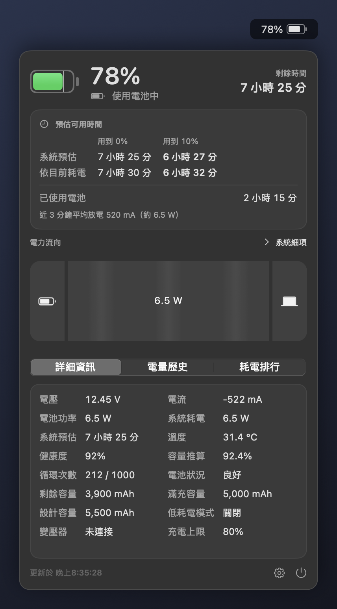
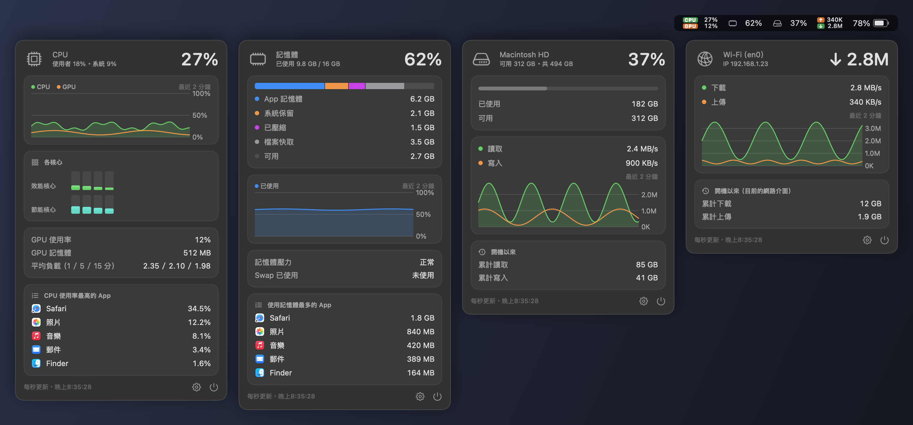
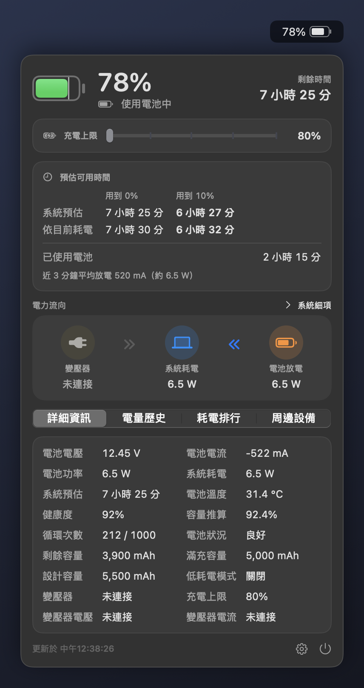

# 電池監控 macbookBatteryMonitor

macOS 選單列的電池資訊 App。選單列直接顯示電量，點開就能看到剩餘時間、健康度、電力流向（可展開到各硬體的耗電）、充電上限、歷史曲線與耗電排行。
每個版本都提供兩種讓你選：只有電池資訊的**電池版**，以及另外有 CPU／GPU、記憶體、磁碟、網路模組的**系統監控版**。

- **只讀取資訊**：不會更動任何充電設定；預設不需要管理員權限，只有選用的「管理員 CPU 取樣」開啟時才要授權
- **每秒更新**：選單列與面板上的資訊每 1 秒刷新一次；面板關閉時 CPU 約 0.2%（電池版）、約 1%（系統監控版，四個模組全開），不會阻止系統睡眠
- **省電模式**：想更省電可在設定開啟，所有資訊改為每 2 秒更新、電力流向改用靜態圖示，不必為了省電改用有 bug 的舊版
- **不需要 Xcode**：只要 Command Line Tools 就能編譯

## 下載與版本選擇

到 [Releases](https://github.com/sgeric910601/macbookBatteryMonitor/releases) 下載。每個版本都有兩個 zip，是同一個 App，差別只在有沒有系統監控模組：

| | 電池版 | 系統監控版 |
|---|---|---|
| 檔名 | `macbookBatteryMonitor-<版本>-battery-macOS-arm64.zip` | `macbookBatteryMonitor-<版本>-status-macOS-arm64.zip` |
| 電池資訊、電力流向、充電上限、通知 | ✓ | ✓ |
| CPU／GPU、記憶體、磁碟、網路模組 | — | ✓（選單列各一個圖示，可個別開關） |
| 省電模式（每 2 秒更新、靜態電力流向） | ✓ | ✓ |
| 管理員 CPU 取樣（選用，預設關閉） | ✓ | ✓ |
| 面板關閉時 CPU | 約 0.2% | 約 1%（四個模組全開） |
| 面板關閉時 CPU，省電模式 | 約 0.15% | 約 0.6%（四個模組全開） |
| 適合 | 只想看電池 | 想一次看完整台 Mac 的狀態 |

兩個版本的設定與電量歷史共用，隨時可以互換。

### 電池版



### 系統監控版



### 省電模式

設定 → 省電 → 省電模式。兩個版本都有，開啟後：

- 電池、系統監控模組、耗電排行與 App 排行都改為每 2 秒取樣一次
- 電力流向改用靜態圖示與箭頭（v1.0.0 的畫法），硬體細項的流帶也不播放動畫



> 截圖為示範數據。CPU 數據為 M1 MacBook Air 實測。

### 舊版本（有已知 bug，不建議使用）

舊版本仍保留在 Releases，但都有下表的 bug，v1.3.0 已全部修正。想省電的話，請用 v1.3.0 的電池版並開啟省電模式，不要改用舊版。

| 已知 bug | v1.0.0 | v1.1.0 | v1.2.1 | v1.2.2 |
|---|---|---|---|---|
| 接著電源但電池仍在放電時（充電器瓦數不足或負載太重），不顯示剩餘時間，**低電量提醒也不會響** | 有 | 有 | 有 | 有 |
| 每次登入都跳出一次「充電完成」通知 | 有 | 有 | 有 | 有 |
| 把「最佳化電池充電」的暫停誤認為充電上限，沒設上限也顯示 80% | 有 | 有 | 有 | 有 |
| 開機自啟動可能同時啟動兩個 App，出現兩個圖示、兩份通知 | 有 | 有 | 有 | 有 |
| 電量歷史檔讀取失敗時被空檔覆蓋，歷史紀錄全部消失 | 有 | 有 | 有 | 有 |
| 面板開著時插拔電源，背景取樣與主執行緒同時讀寫快取，可能閃退 | — | — | 有 | 有 |
| `top` 被強制結束後，CPU 一個核心跑滿、耗電排行卡住 | — | — | — | 有 |
| 電力流向的圓角裁切在版面尺寸過小時觸發繪圖斷言，極少數情況下閃退 | — | 有 | 有 | 有 |
| 插拔電源後約 1 分鐘內，電力流向與功率數字錯誤 | 有 | 有 | — | — |
| 放電到充電上限時，電力流向誤畫成變壓器在供電 | 有 | 有 | — | — |
| 面板開著時動畫每次更新都整個重建，較耗電 | — | 有 | — | — |

| 版本 | 介面 | 下載 |
|---|---|---|
| v1.2.2 | 每秒更新、可展開硬體細項 | [Release](https://github.com/sgeric910601/macbookBatteryMonitor/releases/tag/v1.2.2) |
| v1.2.1 | 選單列每 30 秒更新、可展開硬體細項 | [Release](https://github.com/sgeric910601/macbookBatteryMonitor/releases/tag/v1.2.1) |
| v1.1.0 | 動畫 Sankey 流向圖，選單列每 30 秒更新 | [Release](https://github.com/sgeric910601/macbookBatteryMonitor/releases/tag/v1.1.0) |
| v1.0.0 | 靜態圖示與箭頭，選單列每 30 秒更新 | [Release](https://github.com/sgeric910601/macbookBatteryMonitor/releases/tag/v1.0.0) |

## 安裝

需求：macOS 14 以上、Apple Silicon 的 MacBook（附的 App 為 arm64 版本）。

1. 從 Releases 下載電池版或系統監控版的 zip，解壓縮
2. 把 `macbookBatteryMonitor.app` 拖到「應用程式」資料夾
3. 第一次打開時 macOS 會擋下來（App 沒有 Apple 開發者簽章）。任選一種方式放行：
   - 到「系統設定 → 隱私權與安全性」，在下方找到這個 App，按「強制打開」
   - 或在終端機執行：
     ```bash
     xattr -dr com.apple.quarantine /Applications/macbookBatteryMonitor.app
     ```
4. 第一次啟動會詢問通知權限，並自動加入開機自啟動（可在設定關閉）

要換版本（例如電池版換成系統監控版）時，結束 App 後用另一個 `.app` 覆蓋即可，設定與歷史資料會保留。設定頁最下方會顯示目前的版本號與是哪一版。

## 功能

**選單列**（設定 → 選單列 → 顯示方式）
- 圖示 + 百分比、只有圖示、只有百分比、圖示 + 剩餘時間
- 圖示內百分比 + 剩餘時間（v1.2 起）：電量顯示在電池圖示裡，右側是剩餘／充滿時間；沒有時間資料顯示「—」，滿電、接電未充電、到達上限時分別顯示「已充飽」、「接電」、「已達上限」
- 充電中顯示閃電、接電未充電顯示插頭、低電量變紅

**面板**
- 電量、充放電狀態、剩餘時間／充滿時間（有充電上限時顯示充到上限的時間）
- 預估用到 0% 與**用到 10%** 的時間：系統預估 + 依近 3 分鐘平均耗電推算
- 已使用電池多久（這次拔掉電源後）
- 電力流向：變壓器、系統、電池之間的瓦數
- 系統細項（v1.2 起）：展開成螢幕背光、晶片運算、其他（估算）；點晶片再展開 CPU／GPU／ANE
- 詳細資訊：電壓、電流、電池功率、系統耗電、系統預估、溫度、健康度、循環次數、容量（mAh）、變壓器、充電上限
- 電量歷史圖表（1 小時／24 小時／7 天，第一次啟動會用 `pmset` 紀錄回填過去幾天）
- 耗電排行：前 5 名 App，同一個 App 的子程序會合併，每秒更新（省電模式每 2 秒）

**系統監控模組**（系統監控版，設定 → 系統監控，可個別開關）
- CPU／GPU：選單列顯示 CPU 與 GPU 使用率；面板有使用者／系統比例、最近 2 分鐘曲線、各核心（效能核心、節能核心）、GPU 記憶體、平均負載、CPU 使用率最高的 App
- 記憶體：選單列顯示使用率（記憶體壓力升高時變橘、變紅）；面板有 App 記憶體、系統保留、已壓縮、檔案快取、可用的組成，以及最近 2 分鐘曲線、Swap、使用記憶體最多的 App
- 磁碟：選單列顯示開機磁碟的已使用比例；面板有已使用／可用容量、讀寫速度與曲線、開機以來的累計讀寫
- 網路：選單列顯示上傳與下載速度；面板有目前的網路介面（Wi-Fi、乙太網路）與 IP、速度曲線、開機以來的累計流量
- 同一個 App 的子程序（例如瀏覽器分頁）會合併到 App 名下

**其他**
- 顯示 macOS 的充電上限（系統設定 → 電池 → 電池健康度與充電）：已達上限、充到上限的時間、高於上限時降到上限的時間
- 低電量／充電完成通知（門檻可調；到達系統充電上限也會通知）；接著電源但電池仍在放電時，低電量提醒照樣會響
- 省電模式：所有資訊每 2 秒更新、電力流向改用靜態圖示
- 滿電接著電源時狀態與流向不會反覆跳動（見下方「電力總覽與硬體功耗」）
- 管理員 CPU 取樣（選用）：CPU 能量計數不更新的機型，可改用 `powermetrics` 取得 CPU 功耗
- 開機自動啟動

## 使用方式

- **左鍵**點選單列圖示：打開面板
- **右鍵**：打開面板、設定、結束
- **電力流向**（v1.2 起）：點「系統」展開硬體細項，點「晶片運算」再展開 CPU／GPU／ANE
- **系統監控模組**（系統監控版）：左鍵打開該模組的面板，右鍵打開設定或結束；按住 ⌘ 可以拖曳調整圖示在選單列的順序
- **設定**：選單列顯示方式、省電模式、系統監控模組開關（系統監控版）、管理員 CPU 取樣、通知門檻、開機自啟動；充電上限由 macOS 控制，App 只讀取顯示，可從設定頁跳到系統設定修改

## 管理員 CPU 取樣（選用，預設關閉）

部分機型（例如下表的 M1、M2 Pro）的 CPU 能量計數不更新，晶片細項的 CPU 只能顯示 0 W。需要 CPU 功耗時，可以在設定 → CPU 功耗打開「管理員 CPU 取樣」，改用系統內建的 `powermetrics` 讀取。不需要的話維持關閉即可，App 完全不會安裝或連線任何服務。

- **開啟**：只有在設定裡親手打開時才會跳出 macOS 的管理員授權視窗，安裝一個只讀取 CPU 功耗的系統服務；不儲存密碼、不修改 sudoers。授權取消或失敗時選項會自動關回去，開 App 或開機時不會跳出密碼視窗
- **取樣**：只在主面板開著時連線，間隔與其他資訊相同（每秒，省電模式每 2 秒）。關閉面板、進入設定頁、睡眠或結束 App 就斷線，`powermetrics` 立即停止，之後完全不通訊；服務閒置 30 秒後自行結束，不常駐，下次打開面板時由系統再啟動
- **關閉**：關掉選項就停止並移除服務。開 App 時若發現選項關著卻留有服務檔案，或服務版本與 App 不符，也會自動移除（不需要密碼）
- **耗電**：只有主面板開著時 `powermetrics` 才會執行，這段時間 CPU 使用量會增加；面板關閉時與沒開這個選項相同
- **安全**：服務只接受安裝時那位使用者的連線，只能開始／停止固定參數的 `powermetrics`（間隔只能是 1 或 2 秒）或移除自己，不接受任意指令、路徑或 PID
- **位置**：服務程式在 `/Library/PrivilegedHelperTools/com.kuan.batterymonitor.cpu/`，啟動設定在 `/Library/LaunchDaemons/com.kuan.batterymonitor.cpu.plist`

等待授權、尚未取得資料或資料逾時時不顯示舊值；系統功耗與 CPU 的取樣時間窗只是近似同步。

## 電力總覽與硬體功耗（v1.2 起）

面板主頁每 1 秒（省電模式每 2 秒）取樣一次，關閉面板、進入設定頁或睡眠時停止取樣。讀取不需要管理員權限（CPU 改用 `powermetrics` 的選用功能除外）。

**滿電時的穩定顯示**（沒有設定系統充電上限時）

滿電時，畫面優先維持「已充飽」，短暫降到 99%／98% 仍保留滿電狀態；低於 98% 恢復一般判定。充電／未充電狀態變化需維持 10 秒才更新，實際拔除或重新接上電源立即更新。系統充電上限沿用原本的判定。

滿電附近的供電方向另做穩定處理：電池功率在 ±2 W 內顯示待命流向，避免 macOS 短暫由電池補充供電時，電池節點左右跳動。後續流向變化持續 10 秒才切換。這只影響狀態與動畫；原始功率不改動，滿電時「電力流向」標題列會顯示即時帶正負號的電池功率。電量低於 98% 就恢復一般判定，所以接著電源仍在放電時，剩餘時間與低電量提醒不受影響。

**電力總覽**（變壓器、系統、電池）

- **變壓器輸入**讀 SMC `PDTR`，**系統耗電**讀 SMC `PSTR`
- **電池功率**用「變壓器輸入 − 系統耗電」推算，所以三個數字一定對得起來。SMC 的 `PPBR` 在部分機型上與實際充放電功率不符（例如 M1 MacBook Air 充電約 13 W 時只讀到 1～2 W），所以完全不使用；缺少 `PDTR` 或 `PSTR` 時，改用 IORegistry 電壓 × 電流備援，不會把缺少的輸入當成 0 W
- 剛拔電時 `PDTR` 可能殘留舊值，只在系統確認接電時才計入輸入
- macOS 放電到充電上限時會暫停變壓器供電，此時仍視為接電，顯示「已達充電上限」
- SMC 數值即時更新，不會像電池晶片（IORegistry）那樣插拔後延遲約一分鐘；電流由電池功率與電壓換算，數值不加約等於符號。第一頁每秒重新讀取輸入與系統功率，並同步重新計算電池分流。插拔通知後會在 1、3、6 秒各重讀一次

**硬體細項**

- **系統總功耗**：優先讀取 SMC `PSTR`，不可用時退回 IORegistry 的 `SystemLoad`
- **螢幕背光**：讀取 SMC 感測器
- **CPU／GPU／ANE**：IOReport Energy Model 的能量差除以實際取樣時間；首次取樣只建立基準
- **其他（估算）**：總功耗扣掉背光與已取得的晶片功耗後的差值；缺晶片細項時改標示「未分類（估算）」，裡面也包含缺少的項目
- 晶片合計只涵蓋取得的 CPU、GPU、ANE，不代表完整 SoC 功耗，也不含外接螢幕

IOReport 是系統私有介面，可用性依晶片與 macOS 版本而異，讀不到的項目顯示「—」：

| 機型 | 系統總功耗 | 背光 | GPU | CPU | ANE |
|---|---|---|---|---|---|
| M2 Pro | ✓ | ✓ | ✓ | 顯示 0 W（通道未持續更新）；開啟管理員 CPU 取樣可讀到 | 閒置時 0 W |
| M1 MacBook Air | ✓ | — | ✓ | 顯示 0 W（通道未持續更新）；開啟管理員 CPU 取樣可讀到 | — |

## 更新頻率與省電設計

所有即時資訊每 1 秒更新（省電模式每 2 秒），但每次只做必要的讀取。M1 MacBook Air 實測：

| 情況 | CPU | 省電模式 |
|---|---|---|
| 面板關閉，電池版 | 約 0.2% | 約 0.15% |
| 面板關閉，系統監控版（四個模組全開） | 約 1% | 約 0.6% |
| 打開電池面板（耗電排行分頁） | 約 4%，`top` 另佔約 6% | 約 2%，`top` 另佔約 3% |
| 打開 CPU 或記憶體模組面板 | 約 3%，`top` 另佔約 6% | 約 2%，`top` 另佔約 3% |

`top` 只在耗電排行分頁或 CPU／記憶體面板開著時執行，切到其他分頁或關閉面板就停止；面板停在詳細資訊或電量歷史時沒有 `top` 的負擔。

- 面板關著時每秒更新選單列需要的資料（電量、狀態、功率、剩餘時間）；插拔電源另由系統通知立即更新
- 選單列圖示只有在數字、時間或狀態改變時才重畫
- SMC 每個 key 的格式查過一次就記住，之後每個數值只需一次 SMC 呼叫；每秒只讀 `PDTR`、`PSTR` 兩個值，不讀 `PPBR`
- 變壓器規格接上電源後每 30 秒查一次（額定瓦數不會每秒改變）；充電上限檔案用 `stat()` 確認修改時間，變了才重新解析
- 面板每次打開才建立，關閉就連同視窗整個釋放，背景沒有任何畫面在更新
- 硬體細項與 SMC 溫度只在面板開著時讀；選用的管理員 CPU 取樣也只在主面板開著時連線，關閉面板就斷線，服務閒置後自行結束
- 耗電排行只在面板開著且停在該分頁時，持續跑一個 `top` 每秒（省電模式每 2 秒）輸出；切換分頁或關閉面板就停止；`top` 意外結束時會停止監聽，不會空轉
- 流向動畫由 Core Animation 合成（不逐幀更新 SwiftUI），只在面板開著且該線路有供電時播放；支援「減少動態效果」；省電模式改用靜態圖示，完全不播放動畫
- 省電模式把所有計時器與 `top` 的取樣間隔改成 2 秒，切換時立即生效、不必重開 App
- 系統監控版只取樣有開啟的模組；電池版完全不建立模組的圖示與計時器；選單列圖示寬度固定，換數字時不會讓整條選單列重新排版
- 磁碟容量每秒用 `statfs()` 讀（幾微秒），系統可清出的空間（查一次約 12 毫秒）每 5 分鐘校正一次；網路只查目前使用中的介面
- CPU 與記憶體的 App 排行只在該模組面板開著時，持續跑一個 `top` 每秒（省電模式每 2 秒）輸出；關閉面板就停止
- 不是即時讀數的資料不必每秒查：電量歷史每分鐘記一筆（每 15 分鐘寫一次檔，睡眠前和結束時也會存）；健康度每 6 小時查一次（`system_profiler` 每次約需 0.5 秒，健康度以週為單位變化）

## 資料來源

| 項目 | 來源 |
|---|---|
| 電量、電壓、原始電流、容量、循環次數 | IORegistry `AppleSmartBattery` |
| 外部輸入、系統功耗、背光 | SMC（唯讀，`PDTR`、`PSTR`、`PDBR`／`PBwo`） |
| 電池功率 | 由「外部輸入 − 系統功耗」推算；缺少任一路時改用 IORegistry 電壓 × 電流（不使用 `PPBR`） |
| CPU／GPU／ANE 功耗 | IOReport Energy Model 的能量差與實際取樣時間；管理員模式的 CPU 改用 `powermetrics` |
| 系統預估時間、充電狀態 | IOKit Power Sources |
| 健康度（最大容量）、電池狀況 | `system_profiler SPPowerDataType` |
| 溫度 | SMC（唯讀，`TB0T`～`TB2T`） |
| 耗電排行 | `top -o power` |
| 歷史回填、拔電時間 | `pmset -g log` |
| 充電上限 | `/Library/Preferences/com.apple.powerd.charging.plist`（唯讀；macOS 拔電後會清空，App 會記住上次接電時讀到的值） |
| CPU 使用率、各核心 | `host_processor_info` 的累計 tick 差值；核心類型來自 `hw.perflevel0／1` |
| 平均負載 | `getloadavg` |
| GPU 使用率、GPU 記憶體 | IORegistry `IOAccelerator` 的 `PerformanceStatistics` |
| 記憶體組成、壓力、Swap | `host_statistics64`、`kern.memorystatus_vm_pressure_level`、`vm.swapusage` |
| 磁碟容量 | `statfs()`，加上定期校正的系統可清出空間（與 Finder 一致） |
| 磁碟讀寫 | IORegistry `IOBlockStorageDriver` 的累計讀寫位元組 |
| 網路速度與累計流量 | `sysctl` 的 64 位元介面計數器（`NET_RT_IFLIST2`），只查目前使用中的介面 |
| 網路介面與 IP | `SCDynamicStore`（預設路由介面）、`getifaddrs` |
| CPU／記憶體 App 排行 | `top -o cpu`、`top -o mem` |

## 資料存放位置

- 歷史紀錄：`~/Library/Application Support/BatteryMonitor/history.json`（保留 7 天）
- 設定：`com.kuan.batterymonitor`（UserDefaults）
- 管理員 CPU 取樣的服務（只在開啟該選項時存在）：`/Library/PrivilegedHelperTools/com.kuan.batterymonitor.cpu/`、`/Library/LaunchDaemons/com.kuan.batterymonitor.cpu.plist`

## 解除安裝

1. 在 App 設定裡關閉「管理員 CPU 取樣」（有開過的話，會移除系統服務）與「開機時自動啟動」，然後結束 App
2. 刪除 `/Applications/macbookBatteryMonitor.app`
3. 如果先刪了 App、系統服務還留著，在終端機執行：
   ```bash
   sudo launchctl bootout system/com.kuan.batterymonitor.cpu
   sudo rm -f /Library/LaunchDaemons/com.kuan.batterymonitor.cpu.plist
   sudo rm -rf /Library/PrivilegedHelperTools/com.kuan.batterymonitor.cpu
   ```
4. （選擇性）清除資料：
   ```bash
   rm -rf ~/Library/Application\ Support/BatteryMonitor
   defaults delete com.kuan.batterymonitor
   ```

## 從原始碼編譯

只需要 Command Line Tools（`xcode-select --install`），不需要 Xcode。

```bash
git clone https://github.com/sgeric910601/macbookBatteryMonitor.git
cd macbookBatteryMonitor
git checkout v1.3.0          # 或 v1.1.0、v1.0.0，不指定就是最新的開發版
./build.sh                   # 系統監控版：產生 build/macbookBatteryMonitor.app
./build.sh battery           # 電池版
./build.sh install           # 系統監控版，並安裝到 /Applications 啟動
./build.sh battery install   # 電池版，並安裝到 /Applications 啟動
```

## 開發

```bash
Scripts/test-power.sh    # 換算、供電狀態切換、滿電穩定顯示、生命週期、動畫、系統監控與 CPU 服務協定測試（Command Line Tools 可執行）
```

除錯用參數：

```bash
APP=/Applications/macbookBatteryMonitor.app/Contents/MacOS/macbookBatteryMonitor
$APP --dump              # 目前讀到的資料印成 JSON
$APP --dump-hardware     # 每秒輸出硬體功耗，共五筆 JSON
$APP --snapshot <資料夾>  # 在螢幕外把面板各分頁畫成 PNG
$APP --selftest-panel    # 自動開面板 20 秒再關，量測耗電用
$APP --selftest-hardware # 展開晶片、切換設定頁，確認取樣會停止與恢復
$APP --dump-monitors     # 系統監控模組的讀數（間隔 1 秒取樣兩次）印成 JSON
$APP --selftest-monitors # 依序打開 CPU、記憶體模組面板各 10 秒再關，量測耗電用
$APP --screenshots <資料夾> # 用示範數據畫出兩個版本與省電模式的介紹圖（docs/screenshots）
```

發布時 GitHub Actions 會用同一份程式碼編出電池版與系統監控版（`build.sh` 把版本寫進 Info.plist 的 `MBMEdition`），兩個 zip 放在同一個 Release。

`build.sh` 也會把管理員 CPU 取樣用的服務程式（`CPUPowerHelper`）放進 App 的 `Contents/Library/Helpers/`；只有使用者開啟該選項時才會安裝到系統。

只裝 Command Line Tools 時沒有 SwiftUI 的 macro 外掛，所以程式裡不用 `@State`，介面狀態集中在 `PanelState`。
